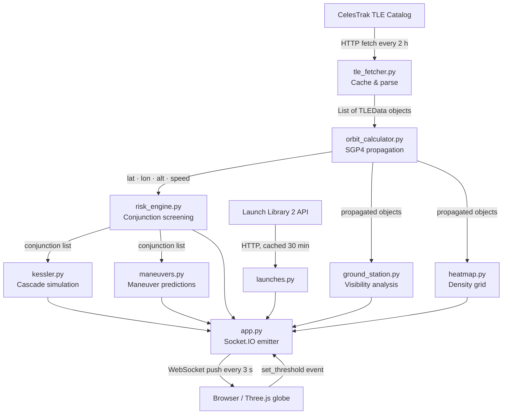

# How It Works

This page explains the data pipeline that runs every 3 seconds to keep the dashboard current.

## Pipeline overview

---

## Stage 1 — TLE fetch and cache (`tle_fetcher.py`)

**What it does:** Downloads satellite orbital elements from CelesTrak and stores them in `backend/tle_cache.txt`.

**Cache logic:**

1. If a healthy cache (≥ 100 objects) exists and is less than 2 hours old, use it directly — no network call.
2. If the cache is stale, attempt a live fetch from `celestrak.org/pub/TLE/catalog.txt`. On success, write the cache only if the new file contains *more* objects than the existing one (prevents a small mirror response from overwriting a large catalog).
3. If the primary URL fails, try two fallback URLs in order: `celestrak.org/NORAD/elements/gp.php?GROUP=active` and the AMSAT mirror.
4. If all fetches fail, serve from the stale cache. If no cache exists at all, raise an error.

A background thread inside `app.py` calls `get_tles()` every 10 minutes to keep the in-memory catalog fresh.

---

## Stage 2 — Orbit propagation (`orbit_calculator.py`)

**What it does:** Takes each TLE and a target UTC datetime and returns the satellite's current geodetic position (latitude, longitude, altitude) and inertial speed.

**How it works:**

1. Parse the two TLE lines into an `sgp4.Satrec` object.
2. Call `sgp4()` with the Julian Date for the requested time. This returns the position and velocity in the TEME (True Equator, Mean Equinox) coordinate frame.
3. Convert TEME to ECEF (Earth-Centred Earth-Fixed) by rotating around the polar axis by the Greenwich Mean Sidereal Time (GMST), computed from the IAU 1982 formula.
4. Convert ECEF to geodetic latitude, longitude, and altitude using Bowring's closed-form method with WGS-84 ellipsoid constants.
5. Compute speed as the magnitude of the velocity vector.

The app propagates up to **2000 objects** per cycle (the `PROPAGATION_LIMIT` constant). Objects beyond position 2000 in the catalog are skipped in the live view.

---

## Stage 3 — Conjunction screening (`risk_engine.py`)

**What it does:** Checks every pair of propagated objects and flags pairs closer than the screening threshold.

**How it works:**

1. Loop over all N×(N−1)/2 pairs.
2. For each pair, compute the 3D distance using `haversine_3d`: first the great-circle surface distance, then add the altitude difference in quadrature.
3. If the distance is below the threshold, call `calculate_collision_probability` to score the pair (see [Concepts — Collision Probability](concepts.md#collision-probability)).
4. Return a list of conjunction dicts sorted by risk level.

One synthetic test object, `TEST_DEBRIS_X`, is always injected near the first catalog object. This guarantees at least one conjunction in the live view regardless of the actual catalog state.

---

## Stage 4 — Kessler cascade (`kessler.py`)

**What it does:** For each of the top 5 closest conjunctions, estimates a hypothetical debris cloud and identifies which nearby satellites would be at risk.

**How it works:**

1. Sort conjunctions by distance. Take the closest 5.
2. For each: compute `primary_probability = min(0.85, 0.015 × (50 / miss_distance)^1.35)`.
3. Place a debris cloud centre halfway between the two objects, with radius 250 km.
4. Find all other satellites within 250 km of the cloud centre. For each, compute a chain probability proportional to the primary probability and the satellite's proximity to the cloud edge.
5. Return the cloud list, affected satellites, and a cumulative `chain_probability_sum`.

The model is deterministic; it does not use random sampling.

---

## Stage 5 — Ground station visibility (`ground_station.py`)

**What it does:** Reports which satellites are currently above the horizon as seen from each of 5 fixed ground stations.

**Ground stations defined in code:**

| ID | Name | Location |
|---|---|---|
| `white_sands` | White Sands | New Mexico, USA |
| `goldstone` | Goldstone DSN | California, USA |
| `madrid` | Madrid DSN | Spain |
| `canberra` | Canberra DSN | Australia |
| `sriharikota` | Sriharikota | India |

For each satellite/station pair, the code converts both positions to ECEF, computes the range vector, then takes the dot product with the station's local vertical (up vector) to get the elevation angle. If elevation ≥ the station's minimum (10° for most stations), the satellite is marked visible.

---

## Stage 6 — Heatmap (`heatmap.py`)

**What it does:** Counts how many tracked objects fall into each latitude/longitude grid cell and returns the density grid for the globe overlay.

---

## Stage 7 — Socket.IO push (`app.py`)

The `emit_objects_worker` background thread ties stages 2–6 together and pushes six event types to all connected browsers every **3 seconds**:

| Event | Content |
|---|---|
| `objects` | Full list of propagated satellite dicts |
| `conjunctions` | Current conjunction list with risk scores |
| `stats` | Summary counts (total objects, orbit distribution, etc.) |
| `ground_visibility` | Visible satellite/station pairs |
| `heatmap` | Density grid |
| `debris_risk` | Kessler cascade result |
| `maneuvers` | Maneuver prediction list |

---

## Frontend rendering (`frontend/globe.js`, `frontend/ui.js`)

The browser receives the Socket.IO events and:

- Updates Three.js satellite positions on the WebGL globe.
- Refreshes HUD panels with the new statistics.
- Draws conjunction threat lines between flagged pairs.
- Renders ground station visibility cones and the orbital heatmap overlay.
